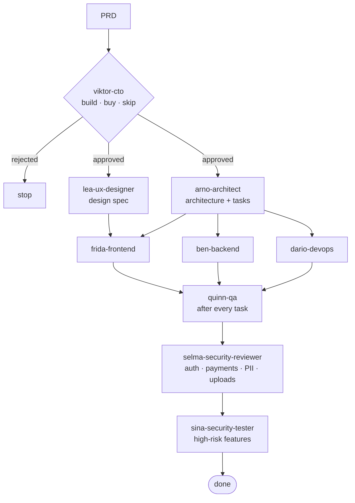

# Claude Code Agent Team

**A nine-agent software delivery team for [Claude Code](https://docs.claude.com/en/docs/claude-code), plus the pipeline rules that make the agents work together.**

I use this setup to build my own products: DocLayer, a maritime document-intelligence platform with about 7,300 automated test cases, and a B2B marketplace MVP.
It gives one developer working with Claude the roles of a whole team: a CTO who can say *no*, a designer who writes specs before anyone codes,
a QA engineer who tests the running system rather than the diff, and a pentester who tries to break it.

## The team

| Agent | Role | Model | Tools | Writes |
|---|---|---|---|---|
| [`viktor-cto`](.claude/agents/viktor-cto.md) | Challenges the PRD: problem, build/buy/skip, top risks, effort. **Can reject.** | Opus | Read, Write, Glob, Grep, WebSearch | `docs/cto-review/<feature>.md` |
| [`lea-ux-designer`](.claude/agents/lea-ux-designer.md) | User flows, screen inventory, component states, microcopy, edge-case UX | Opus | Read, Write, Glob, Grep | `docs/design/<feature>.md` |
| [`arno-architect`](.claude/agents/arno-architect.md) | ADR, API contracts, data model, task breakdown tagged `[BACKEND]` `[FRONTEND]` `[DEVOPS]` `[QA]` | Opus | Read, Write, Glob, Grep | `docs/architecture/<feature>.md` |
| [`ben-backend`](.claude/agents/ben-backend.md) | Implements backend tasks exactly per contract, with unit tests (happy path + ≥2 error cases) | Sonnet | Read, Write, Edit, Bash, Glob, Grep | code + tests |
| [`frida-frontend`](.claude/agents/frida-frontend.md) | Implements frontend tasks against the design spec: loading, error and empty states, accessibility | Sonnet | Read, Write, Edit, Bash, Glob, Grep | code |
| [`dario-devops`](.claude/agents/dario-devops.md) | Multi-stage Dockerfiles, compose/k8s, CI/CD, secrets via env, health checks, pinned images | Sonnet | Read, Write, Edit, Bash, Glob, Grep | infra |
| [`quinn-qa`](.claude/agents/quinn-qa.md) | Exhaustive end-to-end testing of the **running** app: every flow, button, state transition and route | Opus | Read, Bash, Glob, Grep | QA report |
| [`selma-security-reviewer`](.claude/agents/selma-security-reviewer.md) | Fast static review: injection, authz/IDOR, secrets, CSRF/CORS, SSRF, rate limits | Sonnet | Read, Grep, Glob | prioritised findings |
| [`sina-security-tester`](.claude/agents/sina-security-tester.md) | Attacker-mindset dynamic testing with working PoCs: JWT attacks, IDOR, privilege escalation, races | Opus | Read, Bash, Glob, Grep | pentest report |

Opus handles the roles that need judgement (strategy, design, architecture, QA, pentest). Sonnet handles implementation and the fast static security review.

## The pipeline



Each stage produces a written artifact, and the next stage refuses to start without it. Architecture never starts without an approved CTO review,
and frontend never starts without a design spec.

## Hard rules

From [`CLAUDE.md`](CLAUDE.md):

- No agent modifies another agent's domain; conflicts surface as reports, not silent rewrites.
- No implementation without an approved architecture doc; no frontend without the design spec.
- No "done" without Quinn's sign-off. Security findings block release unless explicitly waived.

### Rules learned in production

The last three rules were added after real incidents while building DocLayer:

1. **No control may claim an effect the server does not deliver, or a restriction the server does not impose.** A switch that saved a preference nothing read was the first kind of bug. A label telling admins that un-departmented accounts had *no* access, when those were in fact the *unrestricted* ones, was the second and more dangerous kind.
2. **HTTP-level verification does not count as UI verification.** A grid editor was completely broken in the browser (`structuredClone()` throws on a Svelte `$state` proxy) while every curl-based test passed. Any task that changes a screen needs someone to open that screen.
3. **Every agent reports what it did *not* test.** A report that leaves out its own blind spot reads as full coverage.

## Install

```bash
# per project
cp -r .claude/agents  /path/to/your-repo/.claude/
cp CLAUDE.md          /path/to/your-repo/

# or for every project on your machine
cp .claude/agents/*.md ~/.claude/agents/
```

Then, inside Claude Code:

```text
> Use viktor-cto to review docs/prd/invoice-export.md
```

The rules in `CLAUDE.md` take it from there.

## Adapting Quinn and Sina

Both test agents come with a complete worked test plan for a B2B tender marketplace (buyers, sellers, admin). It covers registration and refresh-token rotation,
the product catalogue, the tender lifecycle across rounds, offers, orders, messaging, role isolation, route crawling and dead-link detection.
Keep the structure and replace the endpoints, payloads and seed accounts with your own app's. The accounts used (`buyer1@example.com` and so on) are local test fixtures.

---

Hartmut Molzahn · [github.com/hmomec](https://github.com/hmomec)
